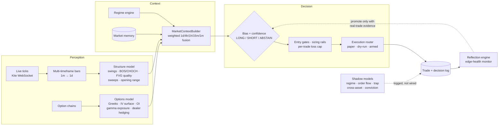
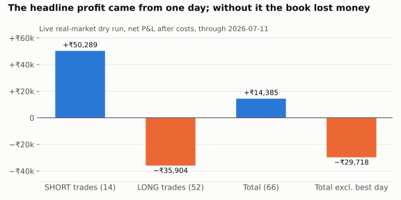

# NSE Market Intelligence v2

**An autonomous market-intelligence model for Indian index options (Nifty, BankNifty, Sensex). Every trading
day it ran on a cloud VM against live Zerodha market data: it perceived the market tick by tick, fused
five timeframes into a directional view, priced real option chains, decided whether to act, and graded
its own decisions. An LLM analyst (Claude) was benchmarked against it on the same real data.**

[](https://github.com/Madhubala1985/nse-market-intelligence-v2/actions/workflows/tests.yml)


> **Status:** the system is production-grade and could place real orders behind 9 safety interlocks. It was
> **deliberately never given real money**, because its own validation showed the edge was not proven
> out-of-sample. Reaching that decision from data, rather than hope, is the point of the project.

---

## How the model thinks



A plain-language walkthrough of every step is in [`docs/HOW_THE_MODEL_WORKS.md`](docs/HOW_THE_MODEL_WORKS.md).

### Key ideas
- **Hierarchical context fusion.** Structure is read on five timeframes and fused into one bias with a confidence score. The 4h and 1d views carry about 60% of the weight, which turned out to be the model's main weakness (see results).
- **Shadow-first learning.** New sub-models (regime, order flow, trap probability, cross-asset, conviction) run in *shadow*: they log predictions next to real outcomes for weeks and only get wired in if they improve real trades. Most were measured and rejected, and the rejections are documented.
- **Self-grading.** A reflection engine and an edge-health monitor track per-bucket expectancy and flag decay, so the model notices when it is "going dumb".
- **LLM analyst benchmark.** Claude acted as a discretionary analyst on the same real option chains, logged its own trades, and was compared against the model in causal replay (11 Sensex days: net −₹172, so no edge for the LLM either).
- **Foundation-model evaluation.** The Kronos time-series foundation model was tested on direction and volatility forecasting with strictly causal inputs, judged on whether a signal could clear trading costs rather than on MSE.

## Results (honest, cost-adjusted)



**Live real-market dry run (66 trades, through 2026-07-11):**

| Bucket | Trades | Win rate | Net P&L |
|---|---|---|---|
| SHORT trades | 14 | 57% | **+₹50,289** |
| LONG trades | 52 | 34% | **−₹35,904** |
| **Total** | 66 | 39% | **+₹14,385** |

The headline is positive, but the model's own diagnostics traced it to one day (+₹44,102 on 2026-06-29).
Without that day the book was **−₹29,718**. The root cause: the multi-timeframe fusion "froze" on LONG and
flipped too slowly, and the confidence score had collapsed to a constant. Later causal replays confirmed
**no robust out-of-sample edge**, so real funds stayed disarmed by design.

Historical backtest (BankNifty 1-minute, in-sample): 437 trades, 49.2% win rate, treated only as a
development benchmark.

## Engineering

| Area | What was built |
|---|---|
| **Live operations** | systemd services and timers on an Oracle Cloud ARM VM: auto-start before market open, daily Kite token via TOTP, clean shutdown, log and disk janitors |
| **Event-driven core** | Dependency-ordered async orchestrator, replay-safe event bus, frozen Pydantic event envelopes |
| **Execution modes** | `paper` (simulated), `real_dry_run` (live data, real premiums, no orders), `real_armed` (9 interlocks + explicit operator confirmation) |
| **Fail-closed safety** | Feed-stall watchdog with forced reconnect, broker-truth position reconciliation, unconfirmed fills treated as uncertain (halt + alert), per-order lot caps tested to block before the broker |
| **Validation tooling** | Causal replay with startup-state snapshots, replay-vs-live parity ledger, cost-hurdle analysis, ex-best-day reporting on every metric |

### `platform_core/` modules

| Module | Responsibility |
|---|---|
| `core/` · `orchestration/` | Enums, event envelopes, protocols, settings; async orchestrator and event bus |
| `data/` | Kite WebSocket adapter, bar builders, live structure pipeline, Redis/TimescaleDB persistence, replay |
| `analytics/structure/` | Causal swings, BOS, CHOCH, FVG quality scoring, sweep validation, session context, opening range |
| `options/` | Greeks, IV and IV-surface engines, OI analytics, gamma exposure, dealer hedging, strike selection |
| `intelligence/` | MarketContextBuilder (multi-timeframe fusion), HTF bias engine, bias detector |
| `adaptive/` | Regime engine, adaptive policy, market memory, reflection engine |
| `ml/` | Feature pipeline, regime / continuation / reversal / trap-probability classifiers, confidence engine |
| `risk/` · `execution/` | Risk fractions, liquidity gate, circuit breakers; execution router, broker adapters, reconciliation |

## What this project demonstrates
- Designing a real-time, multi-model decision system and running it unattended in production hours
- Feature engineering on market microstructure and options data (Greeks, IV surface, GEX, OI)
- Evaluating models the honest way: causal replay, shadow deployment, cost-aware metrics, outlier-robust reporting
- Benchmarking LLM and foundation-model approaches against a quantitative baseline
- Cloud deployment and operations (Oracle Cloud, systemd, cron), safety-critical fail-closed engineering

## Repository layout
```
platform_core/   the live model (see module table)
scripts/         studies, causal replay, LLM-vs-model replay, Kronos evaluation, diagnostics
deploy/          Oracle Cloud setup, systemd units, TOTP token refresh, VM sync
docs/            how the model works, handoff, rollout and arming runbooks
forex/           exploratory gold/forex shadow tooling
tests/           unit and integration tests (incl. mocked real-order path)
configs/         templates only, no credentials
```

## Quick start
```bash
python -m venv .venv && source .venv/bin/activate
pip install -r requirements.txt
pytest
cp deploy/secrets.env.example deploy/secrets.env   # your own Kite Connect credentials
python scripts/run_supervised_live_session.py --execution-mode paper
```
See [`deploy/README.md`](deploy/README.md) for the always-on VM deployment. Large market-data recordings
and logs are not included.

## Related projects
| Project | Domain | Focus |
|---|---|---|
| [XAU Market Intelligence](https://github.com/Madhubala1985/xau-market-intelligence) | Gold, MT5 | Statistical validation of what a model is allowed to learn |
| [NSE Market Intelligence v1](https://github.com/Madhubala1985/nse-market-intelligence-v1) | Indian index options | Foundation: event-driven perception and context pipeline |
| **NSE Market Intelligence v2** (this repo) | Indian index options | Live autonomous model on cloud infrastructure, LLM analyst benchmark |

---
*Built with AI pair-programming (Claude Code). Research and education only; not financial advice.
No real-money orders were placed.*
